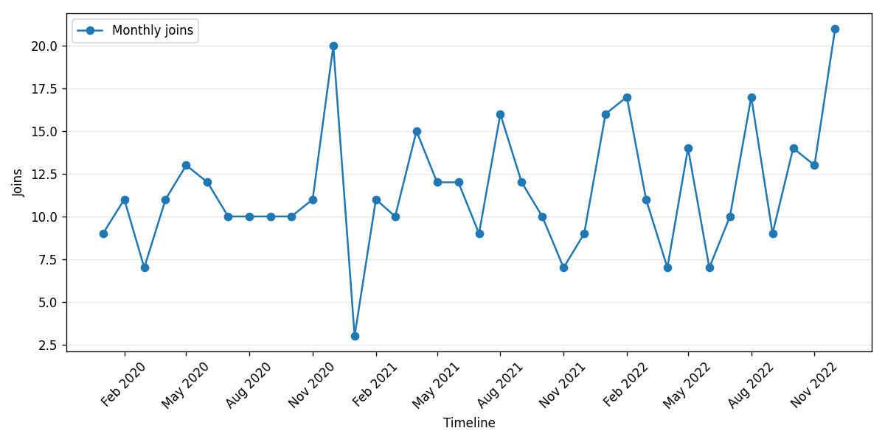
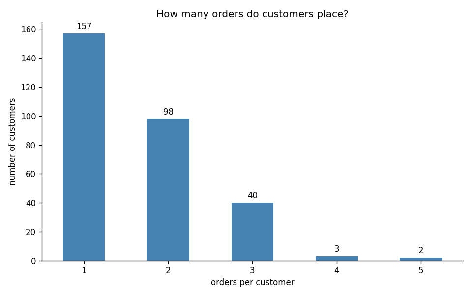
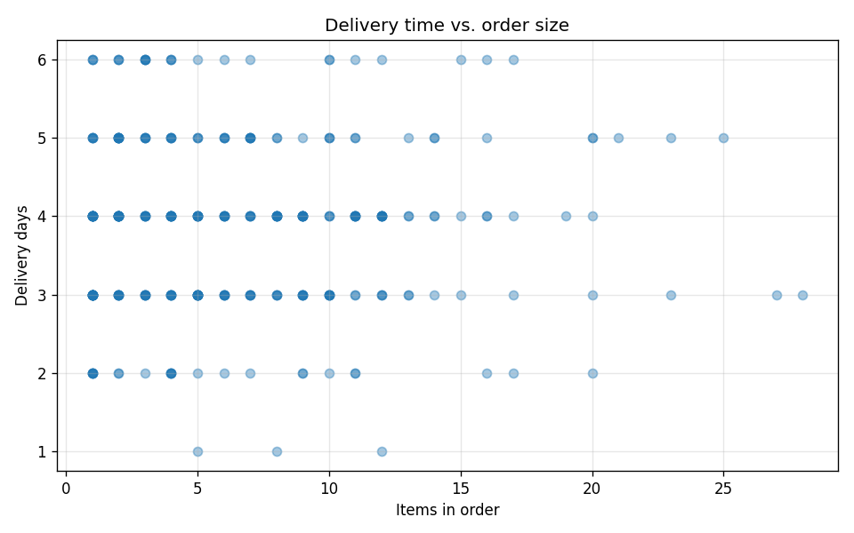

# Retail Sales & Customer Analysis


A Python data analysis project that explores customer demographics, signup trends, product inventory, ordering behavior, and delivery times across four related retail datasets.

Originally developed as part of my Ecom School coursework and extracted into a standalone repository with its relevant Git history preserved.

[Getting Started](#getting-started) · [Analysis](#analysis) · [Visualizations](#visualizations) · [Data Preparation](#data-preparation)

## Overview

The project loads CSV files, prepares the data, and produces console summaries and saved charts. It demonstrates working with related tables using pandas joins, grouping, aggregation, date handling, and visualization.

## Analysis

| Area | Questions explored |
| --- | --- |
| Customer demographics | How are customers distributed by age and gender? |
| Customer acquisition | Which year had the most signups? How do signups vary by year and month? |
| Product inventory | How are products distributed across categories? Which products have the highest and lowest stock? |
| Ordering behavior | How many orders do customers place? Who are the top five customers by order count? |
| Payment methods | How many unique customers use each payment method? |
| Order value | What are the calculated order totals and average order value? |
| Delivery | How does delivery time vary with the number of items ordered? |
| Engagement | Which customers have no orders, and which ordered products have the lowest total quantities? |

## Visualizations

### Customer signups over time



### Ordering frequency



### Delivery time and order size



Additional charts cover customer ages, gender, annual signups, product categories, and payment methods. Browse all outputs in [`charts/`](charts/).

## Data Preparation

The preparation workflow includes:

- Parsing customer joining dates into datetime values.
- Normalizing selected missing-value markers in product brands.
- Deduplicating products by name and customers by email, prioritizing records with fewer missing values.
- Remapping linked product and customer IDs after deduplication.
- Removing records missing mandatory fields.
- Applying a configurable missing-value threshold, set to **5%**: dropping affected rows for columns at or below the threshold and filling columns above it with type-dependent defaults.
- Filtering related records when referenced entities are removed.

These rules reflect the coursework implementation. Missing numeric values can be represented by `-1`; inventory summaries exclude negative stock values, and the delivery plot excludes negative delivery durations.

## Datasets

| File | Contents |
| --- | --- |
| [`data/Items.csv`](data/Items.csv) | Product names, categories, prices, stock, brands, and availability |
| [`data/customers.csv`](data/customers.csv) | Customer demographics, joining dates, and contact fields |
| [`data/orders.csv`](data/orders.csv) | Customer references, order dates, payment methods, delivery details, and order source |
| [`data/order_item.csv`](data/order_item.csv) | Order line items linking orders to products and quantities |

Orders link to customers through `customer_id`. Order line items link to orders through `order_id` and products through `item_id`.

## Getting Started

### 1. Clone the repository

```bash
git clone https://github.com/noname1134/retail_data_analysis.git
cd retail_data_analysis
```

### 2. Create and activate a virtual environment

Linux / macOS:

```bash
python3 -m venv .venv
source .venv/bin/activate
```

Windows PowerShell:

```powershell
py -m venv .venv
.venv\Scripts\Activate.ps1
```

### 3. Install dependencies

```bash
python -m pip install pandas numpy matplotlib scipy
```

### 4. Run the analysis

Run from the repository root so the relative data and chart paths resolve correctly:

```bash
python main.py
```

The script prints summaries, saves eight PNG charts in `charts/`, and opens plot windows. Close each plot window to let execution continue.

For an environment without a graphical display, use Matplotlib's non-interactive backend. On Linux / macOS:

```bash
MPLBACKEND=Agg python main.py
```

**Data output:** running the analysis adds or recalculates the `total_price` column in `data/orders.csv`. Existing chart files are also overwritten. Keep a copy of the input files if you want to preserve their original state.

## Repository Structure

| Path | Purpose |
| --- | --- |
| `main.py` | Dataset loading, cleaning, analysis, and plotting |
| `data/` | Four related CSV datasets |
| `charts/` | Saved analysis visualizations |

## Scope

This is an educational, script-based exploratory analysis. It produces descriptive summaries and visualizations rather than a dashboard or predictive model. The delivery scatter plot supports visual exploration; it does not establish a causal relationship.

## Author

[Liad Illouz](https://github.com/noname1134)
